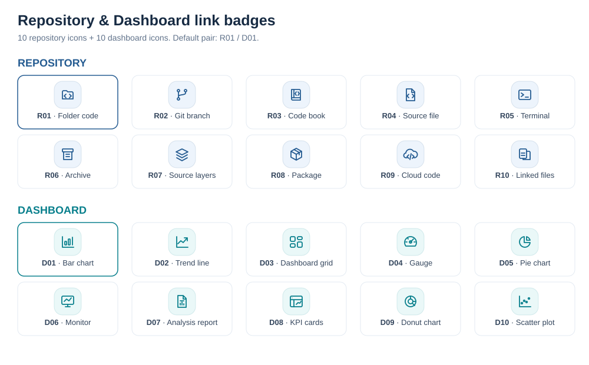
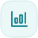

# Repository · Dashboard 아이콘

각각 10종의 SVG 링크 배지입니다. 현재 표에는 **R01 / D01**을 사용합니다. 파일 번호를 바꾸면 다른 디자인을 적용할 수 있습니다.

## Repository

| 번호 | 아이콘 | 디자인 |
| --- | --- | --- |
| R01 |  | Folder code |
| R02 |  | Git branch |
| R03 |  | Code book |
| R04 |  | Source file |
| R05 |  | Terminal |
| R06 |  | Archive |
| R07 |  | Source layers |
| R08 |  | Package |
| R09 |  | Cloud code |
| R10 |  | Linked files |

## Dashboard

| 번호 | 아이콘 | 디자인 |
| --- | --- | --- |
| D01 |  | Bar chart |
| D02 |  | Trend line |
| D03 |  | Dashboard grid |
| D04 |  | Gauge |
| D05 |  | Pie chart |
| D06 |  | Monitor |
| D07 |  | Analysis report |
| D08 |  | KPI cards |
| D09 |  | Donut chart |
| D10 |  | Scatter plot |

